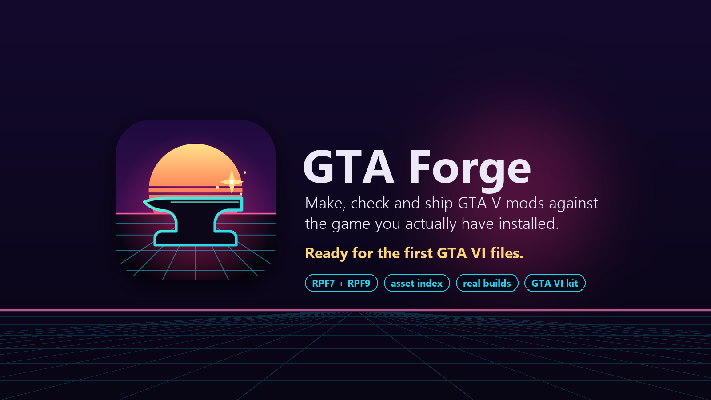
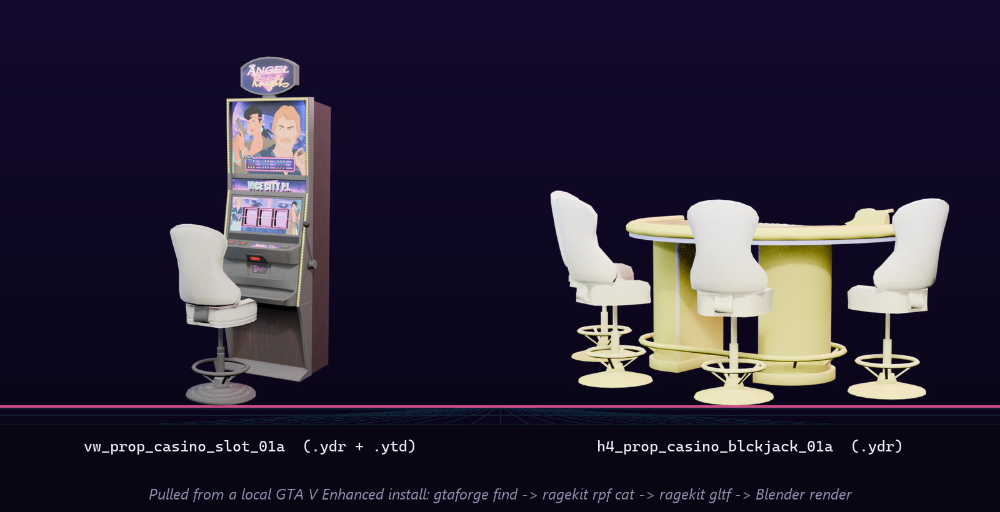
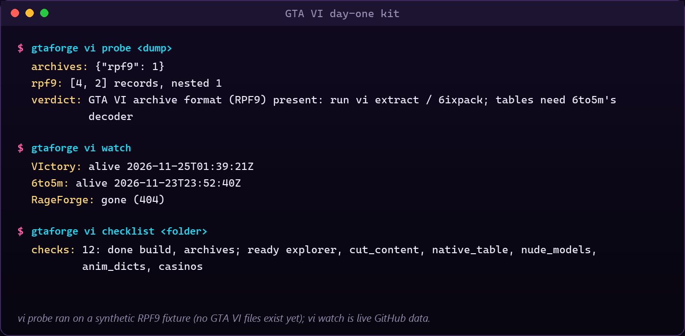
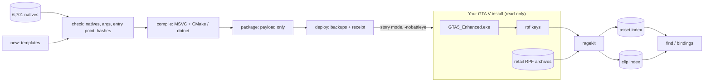

<div align="center">



[](https://github.com/SenjuWoo/Gta-Forge/actions/workflows/ci.yml)
[](https://github.com/SenjuWoo/Gta-Forge/releases)
[](pyproject.toml)
[](pyproject.toml)
[](LICENSE)

**[Install](#install)** · **[Tour](#a-two-minute-tour)** · **[Commands](#commands)** · **[GTA VI kit](#the-gta-vi-day-one-kit)** · **[How it works](#how-it-works)** · **[Changelog](CHANGELOG.md)**

</div>

GTA Forge is a command-line workbench for **single-player GTA V mods** (Legacy and
Enhanced). Instead of trusting a wiki page from 2015, it reads the game you have
installed: every archive entry, every animation clip, the exe version and the
frameworks next to it. Then it builds, checks, packages and test-deploys your mod
against that.

It also carries a **GTA VI day-one kit**. No PC build of GTA VI exists yet, so
the kit is built and tested now on synthetic RPF9 archives and on GTA V as a
control, ready for the day the first real files arrive.

## What you get

- **No more guessing names.** `find` tells you whether an anim dict, model or texture exists in *your* install and which archive holds it. `anim clips` reads the clip names out of the game itself, and `natives` covers all 6,701 GTA V natives.
- **Builds that load.** The C++ template registers with ScriptHookV the right way and ships a current `natives.h`. MSVC is found automatically, so no developer prompt is needed. The SHVDN template builds with the plain .NET SDK.
- **Checks before the game ever starts.** Every native call is checked for name, namespace and argument count, for both C++ and SHVDN. It also checks the ScriptHookV entry point and Menyoo model hashes, and that packages hold no sources, framework DLLs or secrets.
- **Safe test installs.** `deploy` copies only the build outputs, backs up whatever it replaces, and `deploy --remove` puts the game back exactly as it was.
- **Retail archives, read-only.** The NG-encrypted RPFs open through ragekit, using keys derived from your own exe. Mod archives (OPEN RPF7) are read and written in pure Python.
- **JSON everywhere.** Every command prints one JSON object with stable exit codes (0 ok, 1 findings, 2 a named problem with a fix). Built for scripts and AI agents, readable by people.


## Install

**Windows:** download the source zip from the [latest release](https://github.com/SenjuWoo/Gta-Forge/releases/latest), extract it, and run `START-HERE.bat`. Or from a shell:

```powershell
git clone https://github.com/SenjuWoo/Gta-Forge
cd Gta-Forge
powershell -ExecutionPolicy Bypass -File Install.ps1
gtaforge doctor
```

**Any OS with Python 3.10+:**

```bash
python -m pip install -e .
gtaforge doctor
```

The forge itself needs nothing beyond Python. Optional tools unlock more, and `doctor` tells you which ones it found:

| Tool | Unlocks |
|---|---|
| [ScriptHookV SDK](https://dev-c.com/gtav/scripthookv/) + Visual Studio C++ (Build Tools are enough) + CMake | building `.asi` plugins |
| .NET SDK + `ScriptHookVDotNet3.dll` (from your game folder or the SHVDN release) | building SHVDN scripts |
| [ragekit](https://github.com/RatPrez/ragekit) + [CodeWalker](https://github.com/crxhvrd/CodeWalkerProjects/releases) | reading retail archives, the asset index, clip names |
| [6to5m / 6ixpack](https://github.com/DesignWithTommy/6to5m) | extracting GTA VI RPF9 archives |

If your tools live somewhere unusual, list the folders in `%LOCALAPPDATA%\GTAForge\config.json`:

```json
{"tool_dirs": ["D:\\modding\\tools"]}
```

## A two-minute tour

```text
gtaforge doctor                                   # what's installed, what's missing, how to fix it
gtaforge rpf keys                                 # once: archive keys from your own game exe
gtaforge index build                              # once per patch: every archive entry, a few seconds
gtaforge find mini@strip_club@idles@stripper      # does it exist? where?
gtaforge anim clips --dict mini@strip_club@idles@stripper
gtaforge new NeonNights --kind cpp --kind menyoo --target-game enhanced
gtaforge check --compile --project NeonNights
gtaforge package --project NeonNights
gtaforge deploy --dry-run --project NeonNights    # then without --dry-run; story mode, -nobattleye
gtaforge logs --mod NeonNights
```


The same index that confirms names also feeds the asset pipeline. Here two casino props are pulled straight out of a local install and rendered:



## Commands

| Need | Command |
|---|---|
| Health check, as separate sections | `gtaforge doctor` |
| Every command and option, as JSON | `gtaforge capabilities` |
| Route a request to the right surface and docs | `gtaforge plan "add a blackjack table"` |
| Is this asset in my game? | `gtaforge find <name> [--ext .ycd]` · `find --batch names.txt` |
| Clip names, read from the game | `gtaforge anim clips --dict <d>` · `anim build --batch dicts.txt` |
| Native signature or hash | `gtaforge natives <name\|part\|0xhash>` · `natives --header inc/natives.h` |
| joaat hashes | `gtaforge hash --joaat adder zentorno` |
| Archives | `gtaforge rpf info\|list\|find\|extract <rpf>` · `rpf pack <folder> --out dlc.rpf` |
| New project | `gtaforge new <name> --kind cpp\|shvdn\|menyoo\|xml\|lua` |
| Check, compile, build | `gtaforge check --compile` · `compile` · `build` |
| Release loop | `bump` · `package` · `validate` · `deploy` · `logs` · `conflicts` · `nexus` |
| Binding tables (content keys to game assets) | `gtaforge bindings <keys.json> <table.json>` |
| GTA VI | `gtaforge vi status\|watch\|probe\|checklist\|names\|extract\|tools\|build-6to5m` |

Knowledge docs ship with the tool: `gtaforge knowledge` lists them (formats, RPF,
scripts, anims, deploy, packaging, bindings, GTA VI).

## The GTA VI day-one kit



| Command | On day one |
|---|---|
| `vi probe <folder>` | sorts every file by content signature, not extension: executables with version and hash, RPF7/8/9 archives with RPF9 header fields and nested archives, plus audio banks, texture pools and metadata |
| `vi checklist <folder>` | the twelve first checks, run automatically where a tool can, with the exact next command for the rest |
| `vi extract <rpf> [--list]` | extraction through 6ixpack |
| `vi names <hashes> --words <list>` | recovers names from hashed tables: joaat over wordlists, the GTA V asset index and generated variants |
| `vi watch` | live status of the community tools on GitHub, so a takedown is noticed early |

These are honest limits: the probe and checklist have only run on synthetic RPF9
files and on GTA V. Nothing here decrypts GTA VI tables itself; that is 6ixpack's job.

## How it works



- **Standard library only.** No runtime dependencies, no daemon, no network except `vi watch`.
- **Facts are data with sources.** Natives, framework markers, routes and the GTA VI watch live in versioned files under `src/gtaforge/knowledge/`.
- **Separate evidence tiers.** Every report keeps static, compile, load and gameplay results apart, so a passed check is never reported as a working mod.
- **Your keys stay yours.** Archive keys are derived on your machine and live in `~/.ragekit/keys`. They are never committed and never shipped.

## Tested

The suite has two halves. The **offline** half uses fake game folders and
synthetic RPF7/RPF9 archives, and includes a fuzz pass that runs every command
with bad input; it runs on every push for Windows and Linux on Python 3.10,
3.13 and 3.14. The **real** half runs against an installed game and toolchain
and skips itself when they are absent. It covers retail archive headers, ragekit
listing and extraction, index lookups, clip reading, a GTA V control probe, name
recovery, and real C++ and SHVDN template builds.

```bash
python tests/run_tests.py
```

## Scope and limits

- Single-player only. Mods and GTA Online don't mix: ScriptHookV closes the game there.
- ScriptHookV support follows dev-c.com. `doctor` warns when your game patch is newer than the hook.
- Loading in game and gameplay are your test. The forge reports them as "not run" until you do.

## Contributing

Issues and pull requests are welcome. A fix starts with a failing test, and
`python tests/run_tests.py` must pass. Format facts need a primary source:
upstream code or the installed files.

## License

MIT, see [LICENSE](LICENSE). Third-party tools keep their own licences
([THIRD-PARTY.md](THIRD-PARTY.md)); nothing third-party is redistributed. Game
assets shown in the screenshots belong to their owners and were extracted from a
locally installed copy for illustration. Version 1.2.1.
