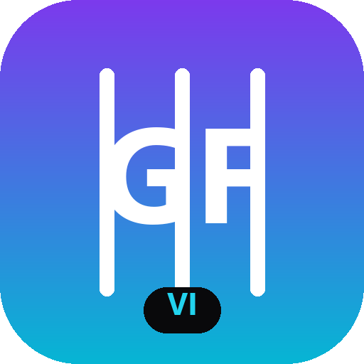

<div align="center">



# GTA Forge

**A local-first workbench for GTA V mods, with a GTA VI day-one kit.**

[](https://github.com/SenjuWoo/Gta-Forge/actions/workflows/ci.yml)
[](https://github.com/SenjuWoo/Gta-Forge/releases)
[](LICENSE)
[](pyproject.toml)
[](#install)

</div>

GTA Forge turns *"add a blackjack table"* or *"why does my asi crash on
Enhanced?"* into a route, real files and a check you can run. It reads your
**installed game** (edition, exe version, frameworks, every archive entry)
instead of trusting a wiki page from 2015.

- **JSON on stdout, stable exit codes** (0 ok, 1 findings, 2 named failure with a fix, 3 bug).
- **Names are confirmed, not guessed.** An asset index of the installed game answers "does `mini@strip_club@idles@stripper` exist and where"; the full native DB (6,701 natives) answers signatures.
- **Builds that load.** The C++ template registers with ScriptHookV correctly and compiles against the SDK with a current `natives.h`; the SHVDN template builds with the .NET SDK.
- **Single-player only.** Never touches GTA Online, never uploads, never launches the game; writes to the game folder only on `deploy`, with backups.
- **GTA VI day-one kit.** No PC build exists yet; `vi probe`, `vi checklist`, `vi names` and `vi watch` already run and are tested on synthetic RPF9 files and on GTA V as a control.

## Install

**Windows:** download the source zip from the latest release, extract it and run `START-HERE.bat`, or:

```powershell
git clone https://github.com/SenjuWoo/Gta-Forge
cd Gta-Forge
powershell -ExecutionPolicy Bypass -File Install.ps1
gtaforge doctor
```

**Any platform with Python 3.10+:** `python -m pip install -e .` then `gtaforge doctor`.

`doctor` reports, as separate sections: the game (edition, patch, ScriptHookV
support, frameworks), the build toolchain (MSVC via vswhere, CMake, the SDK,
dotnet), archive tools and keys, the asset index, and any GTA VI folder.

Personal tool folders (CodeWalker, the ScriptHookV SDK, an SHVDN copy) go in
`%LOCALAPPDATA%\GTAForge\config.json` as `{"tool_dirs": ["D:\\tools"]}`.

## The tour

```text
gtaforge doctor
gtaforge rpf keys                       # once: archive keys from your own game exe
gtaforge index build                    # once per patch: ~389k entries in seconds
gtaforge find anim_casino_b@amb@casino@games@blackjack@dealer
gtaforge natives TASK_PLAY_ANIM
gtaforge new MyMod --kind cpp --kind menyoo --target-game enhanced
gtaforge check --compile --project MyMod
gtaforge package --project MyMod && gtaforge validate MyMod/artifacts/MyMod-0.1.0.zip
gtaforge deploy --dry-run --project MyMod
gtaforge deploy --project MyMod         # story mode, -nobattleye
gtaforge logs --mod MyMod
```

| Need | Command |
|---|---|
| Health | `gtaforge doctor` |
| Every command and option | `gtaforge capabilities` |
| Route a request | `gtaforge plan "<request>"` |
| Is this asset in the game? | `gtaforge find <name> [--ext .ycd]`, `find --batch names.txt` (after `index build`) |
| Native signature / hash | `gtaforge natives <name\|part\|0xhash>`; `--header inc/natives.h` |
| Clip names from the game | `gtaforge anim clips --dict <d>`, `anim build --batch dicts.txt` |
| joaat | `gtaforge hash --joaat adder` |
| Archives | `gtaforge rpf info\|list\|find\|extract <rpf>`, `rpf pack <dir> --out dlc.rpf` |
| Projects | `gtaforge new <name> --kind cpp\|shvdn\|menyoo\|xml\|lua` |
| Check / compile / build | `gtaforge check --compile`, `compile`, `build` |
| Release loop | `bump`, `package`, `validate`, `deploy`, `logs`, `conflicts`, `nexus` |
| Binding tables | `gtaforge bindings <keys.json> <table.json>` |
| GTA VI | `gtaforge vi status\|watch\|probe\|checklist\|names\|extract\|tools\|build-6to5m` |

## What it covers

| Area | Detail |
|---|---|
| **Scripts** | C++ asi (ScriptHookV SDK, CMake + MSVC found automatically, current natives.h), C# SHVDN v3 (net48), Menyoo Spooner XML, Lua (FiveM) |
| **Static checks** | native exists, namespace, argument count (C++ `NS::NAME(` and SHVDN `Function.Call`), ScriptHookV entry point, Menyoo `ModelHash` = joaat(`HashName`), XML |
| **Archives** | RPF7 reader + OPEN writer in pure Python; NG retail archives through ragekit with keys derived from your exe; RPF9 header reader |
| **Asset index** | every entry of every archive of the installed game, nested; `find` by name and type |
| **Release loop** | payload rules (build outputs, never sources), deterministic zip, validation (sources, path escapes, framework dlls, secrets), deploy with original backups and clean removal |
| **Binding tables** | content keys -> per-game assets, verified against the index, coverage per module: the porting contract for engine-agnostic mods |
| **GTA VI** | content-signature census of any folder, RPF9 headers + nested archives, 12-step first-checks list, joaat name recovery, live GitHub watch of the community tools |

## Architecture

```
gtaforge (Python, stdlib only)
  cli.py              JSON + exit codes; bad usage is exit 2, never a traceback
  game.py             discovery (arg, env, Steam, Rockstar, Epic), editions, frameworks, GTA VI folders
  rpf7.py / rpf9.py   archive formats; rpf.py routes python vs ragekit
  index.py            asset index of the installed game
  natives.py          native DB + natives.h generator
  scripts.py check.py static checks; compilemod.py / build.py real builds
  project.py package.py deploy.py   manifest, payload, zip, deploy receipt
  bindings.py vi.py   binding coverage; GTA VI kit
  knowledge/          facts with tier + source, routes, docs, natives.json.gz
  templates/          cpp, shvdn, menyoo, xml, lua
```

## Evidence, not vibes

Static, compile, load and gameplay are separate claims in every report. The
test suite has an offline part (fake game trees, synthetic RPF7/RPF9 archives,
a fuzz pass that runs every command with bad input) and a real part that runs
against an installed game and toolchain and skips itself when they are absent.

## Limits

- ScriptHookV support follows dev-c.com; `doctor` warns when your patch is newer than the hook.
- NG archive access needs ragekit plus CodeWalker's `magic.dat` on your machine; keys never leave it.
- GTA VI: **no playable PC build exists**. The kit prepares the first day; it is not a VI mod loader.

## License

MIT, see [LICENSE](LICENSE). Third-party tools keep their own licences
([THIRD-PARTY.md](THIRD-PARTY.md)); nothing third-party is redistributed.
Version 1.2.0.
